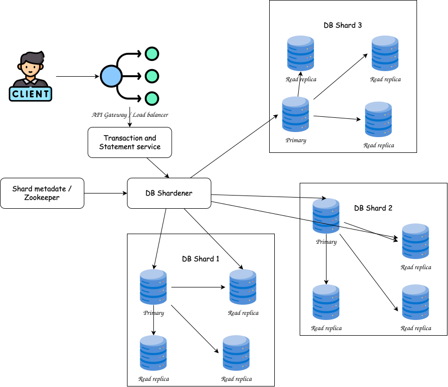
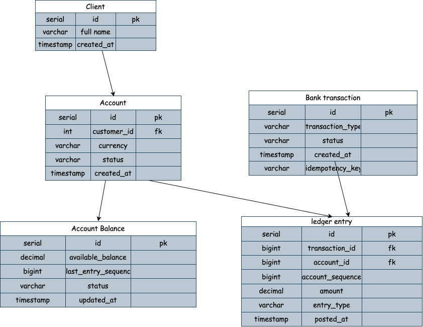

# Report

## Design the database schema.




## Would you store account balances separately from transactions?

Yes. There are two possible approaches.

Approach A: Calculate balance from transactions
```sql
SELECT SUM(amount)
FROM ledger_entries
WHERE account_id = 123456;
```
Advantages:
- No separately maintained balance.
- Ledger remains the only source of truth.
Disadvantages:
- Expensive for accounts with millions of transactions.
- Repeated aggregation consumes database resources.
- Poor performance for frequently accessed accounts.

Approach B: Store balance separately
```sql
SELECT available_balance
FROM account_balances
WHERE account_id = 123456;
```
Advantages:
- Fast balance retrieval.
- No need to scan historical transactions.
- Suitable for high-throughput banking applications.
Disadvantages:
- Balance and ledger must be updated atomically.
- Bugs in update logic can create inconsistencies.

Our decision
Use both:
- `ledger_entries` stores the permanent financial history.
- `account_balances` stores the current balance.

Both must be updated in the same database transaction.
If the transaction fails, both updates must roll back.

## Would you shard transactions by account ID or transaction date?

We have:
- 30 million accounts.
- 500 million transactions every month.
- 6 billion transactions every year.
One database machine will eventually become a storage and performance bottleneck.

Partitioning distributes data across multiple machines. Unlike replication, it does not create additional copies of the same dataset.

There are two main strategies to consider.
Option A: Partition by account ID
```
hash(account_id) % number_of_shards
```

Advantages
- All transactions for an account are located on one shard.
- Account history queries are efficient.
- Account balance updates are local.
- Writes are distributed across shards.

Disadvantages
- A query across all accounts requires multiple shards.
- Transfers between accounts on different shards are more complicated.
- Poor hashing or uneven workloads can create hotspots.

Option B: Partition by transaction date
```
January 2026  -> Partition 1
February 2026 -> Partition 2
March 2026    -> Partition 3
```

Advantages
- Monthly reports can scan only relevant partitions.
- Old transactions can be archived or dropped efficiently after export.
- Time-range queries are efficient.

Disadvantages
- All new transactions go into the newest partition.
- This can create a write hotspot.
- Account history may need to access many partitions.

The partitioning lecture explicitly describes this risk: using the current date as a partition key can concentrate writes in the newest range.

## How would you implement primary-replica replication?

(see 'Design the database schema' section)

## Should statement queries use read replicas?

Yes, but not blindly.
Statement generation is a read-heavy workload. Running all statement queries against the primary could reduce the capacity available for financial writes.
Therefore, I would route statement queries to replicas.
However, there is an important problem: replication lag.
We would solve it with monotonic reads.

## How would you guarantee consistent statements?

I would combine three mechanisms:
1. A clearly defined statement cutoff.
2. A consistent database snapshot using MVCC.
3. A replication synchronization barrier.

## How would you handle late-arriving transactions

## How would you archive old transactions?

## How would you recover from primary database failure?


